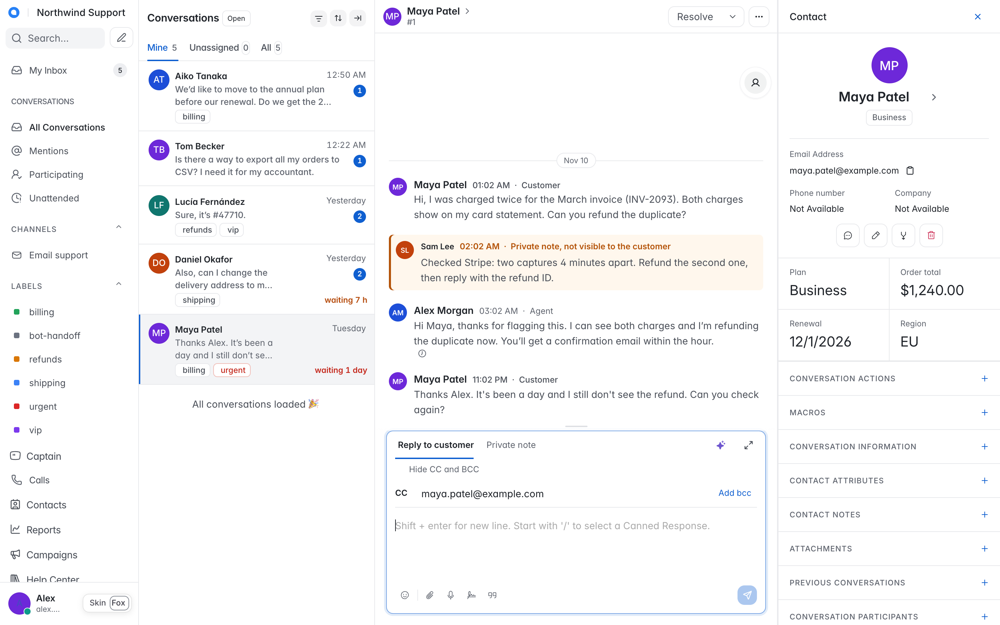
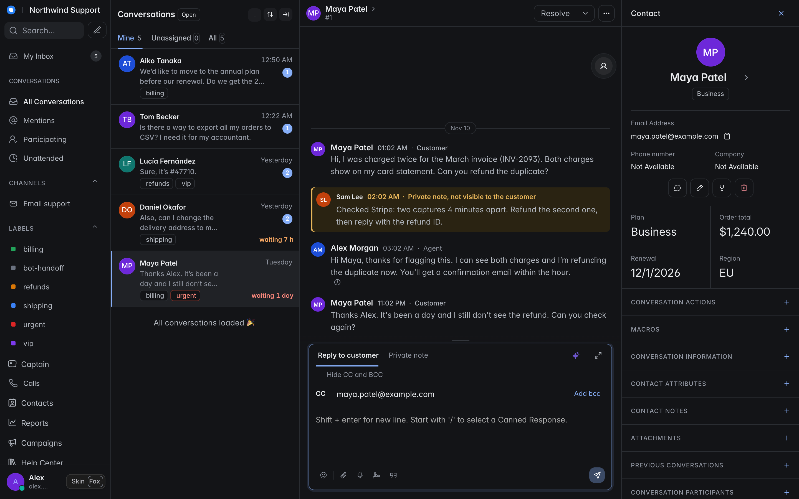
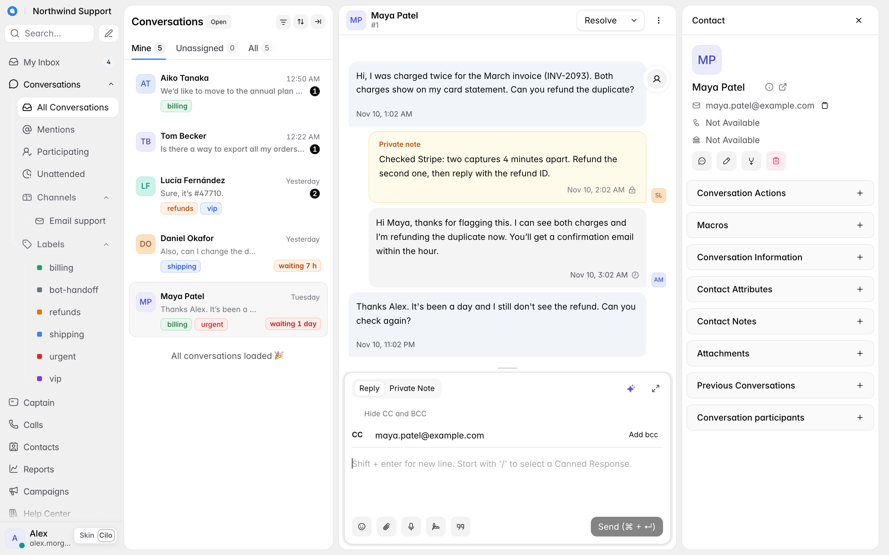

# woot-skins

Skins for the [Chatwoot](https://github.com/chatwoot/chatwoot) agent dashboard. You paste one snippet into Super Admin and every agent gets them. There is no fork, no rebuild and nothing to host.

#

| Fox | Cilo |
|---|---|
|  |  |

- **Fox**:
  - one white frame with hairlines;
  - Slack-style messages that say who wrote each one;
  - a cobalt accent;
  - a case card in the contact panel.
- **Cilo**:
  - white panels on a soft grey canvas;
  - black actions;
  - soft signal chips.

Both skins have light and dark modes and follow the Chatwoot theme. Agents switch skins in the sidebar footer or with `Alt` + `Shift` + `T`.

## What it does

- **Waiting time on the card.** It turns orange, then red, after the hours you set.
- **Private notes you can't mistake for a reply.** This works in the thread and in the composer.
- **Placeholder warning.** A reply that still contains `{{order_id}}` or `[NAME]` is underlined and flagged.
- **Readable labels:**
  - a tone per label;
  - automation labels hidden on cards;
  - prefixes stripped.
- **Conversation attributes.** They are grouped, empty rows are collapsed, and dates stored as `YYYY-MM-DD` show on the right day.
- **Small fixes:**
  - CC and BCC collapsed;
  - the unread count in the tab title;
  - focus mode (`Alt` + `Shift` + `F`).

## Install

You need Super Admin access to a self-hosted Chatwoot. The skins were tested on 4.16.

1. Download [`dist/snippet.html`](dist/snippet.html) from the release you want, or copy it from the website.
2. Open `/super_admin/app_config?config=general`, paste the snippet into **Dashboard Scripts** and save.
3. Reload the dashboard.

To turn it off, add `?wsk=off` to any dashboard URL for a single visit, or delete the snippet to uninstall.

### Inline or linked?

Dashboard Scripts run inside every agent's session, with access to the page. **Paste the snippet inline.** The code then lives in your Chatwoot, and updating is a deliberate copy and paste.

If you prefer a link, pin an exact release and add an integrity hash:

```html
<link rel="stylesheet" href="https://cdn.jsdelivr.net/gh/airton/woot-skins@v0.1.0/dist/woot-skins.css"
      integrity="sha384-xv8FDozaNnCnJxpXUmPFTzwoWCfrGJBhbd3MzKS/5Pjmhkyn5X1huyU8rBBPKBN6" crossorigin="anonymous">
<script src="https://cdn.jsdelivr.net/gh/airton/woot-skins@v0.1.0/dist/woot-skins.js"
        integrity="sha384-QNC4FwSFpIwQTFUYYn6htSFqHfr6YGJo91u/4dwFEs0MlfNwI8mTMyf2/qXO5Faq" crossorigin="anonymous"></script>
```

Each release lists its hashes in the release notes. Never link a moving version such as `@latest` or `@main` from a production dashboard.

## Configure

Everything is optional. Add a script block **before** the snippet:

```html
<script>
window.WOOT_SKINS = {
  themes: ['fox', 'cilo'],          // which skins agents can pick; the first is the default
  locale: null,                     // 'en' | 'pt-BR'; null follows the Chatwoot UI language
  waitHours: [4, 12],               // card turns orange after 4 h waiting, red after 12 h
  labels: {
    critical: '^urgent$',           // regex: labels shown in red
    hidden: '^(bot-|csat-sent$)',   // regex: labels hidden on cards
    tones: { billing: 'green', refunds: 'orange', shipping: 'blue' }, // red | orange | green | blue | gray
    stripPrefix: '^queue-'          // regex removed from the label text on cards
  },
  attributeGroups: [['Billing', '^billing_'], ['Other', '.']], // [title, regex on the attribute key]
  brandAttribute: 'plan',           // conversation attribute shown as a chip under the contact name
  brandNames: { pro: 'Pro plan' },  // optional display names for brandAttribute values
  caseCard: [                       // up to 4 conversation attributes in a 2x2 grid (Fox)
    ['plan', 'Plan'], ['order_total', 'Order total'],
    ['renewal_date', 'Renewal', 'date'], ['region', 'Region']
  ],
  placeholder: '\\[[^\\]\\n]{2,40}\\]|\\{\\{[^}\\n]*\\}\\}' // regex for unfilled variables
};
</script>
```

## How it works

- **Read-only.** The script reads what Chatwoot already rendered: Vue component props and the selected conversation. It never commits to the store or calls the API.
- **Attributes, not classes.** It marks elements with `data-wsk-*` attributes, because Vue rewrites `className` but leaves unknown attributes alone. The CSS draws on top with `::before` and `::after`.
- **Scoped.** Every rule is scoped to `html.wsk[data-wsk-theme="…"]`. The class is only set on `/app/accounts/:id` pages, so login, Super Admin and the website widget are untouched.
- **Fragile by nature.** Some selectors rely on Chatwoot's markup and utility classes. Chatwoot upgrades can break parts of a skin. Pin a version and check it after upgrading.

## Develop

```bash
npm run build       # themes/ + src/ -> dist/ and site/dist/
npm run dev         # rebuild on change
```

Point Dashboard Scripts on a **local** Chatwoot at your dev server while you work, and serve `dist/` with any static server:

```html
<link rel="stylesheet" href="http://localhost:5174/woot-skins.css">
<script src="http://localhost:5174/woot-skins.js"></script>
```

- `themes/_base.css`: shared rules (skin picker).
- `themes/<name>.css`: one file per skin, written against `html.wsk`; the build scopes it.
- `src/woot-skins.js`: the behaviour, config and texts (en, pt-BR).
- `site/`: the landing page, deployed on Vercel (`vercel.json`).

New skins are welcome. Keep the bar the existing ones follow: WCAG AA contrast (4.5:1 for text, 3:1 for components), visible focus, light and dark.

## License

MIT. Not affiliated with Chatwoot Inc. "Chatwoot" is a trademark of its owners. Screenshots use fictional data.
